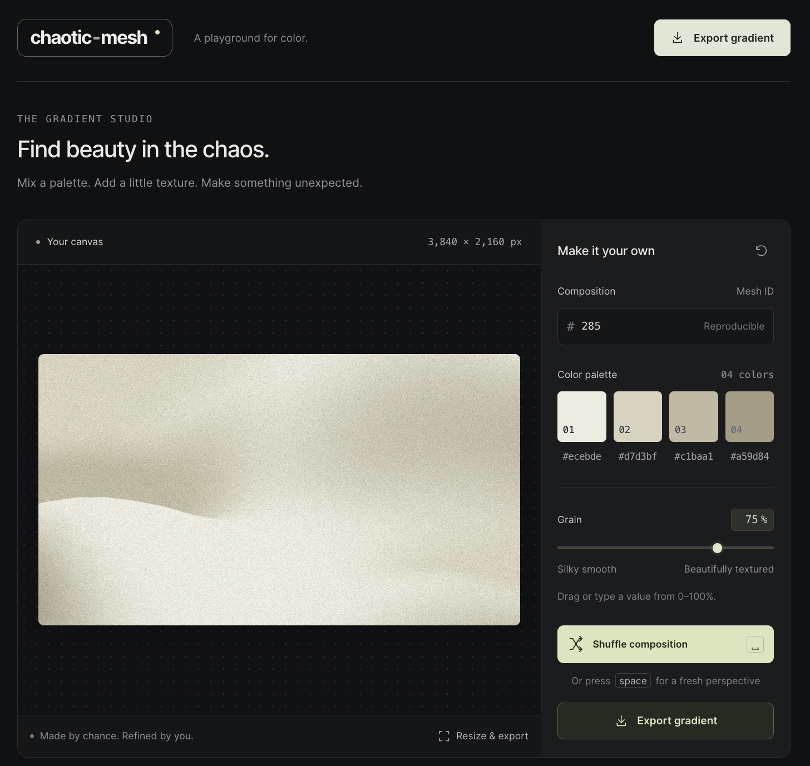

# chaotic-mesh

A private Dark Studio for mesh gradients. Customize four colors and the mesh ID, add monochrome grain, and export full-resolution PNG, JPEG, or WebP images.



## Run locally

Requires Node.js 20 or later (including the project-local Vercel CLI).

```sh
npm install
npm run dev
```

Open the local address printed by Vite. For a production build, run `npm run build`, then `npm run preview`.

## Create and export

- Change colors using the swatches or six-digit hex fields. Use a mesh ID to recreate a composition.
- Shuffle the composition with the button or the space bar while outside an input or button.
- Choose one of 84 Color Hunt palettes to get started. Reset restores the original palette, mesh ID, and zero grain.
- Adjust grain with the slider or type a whole-number percentage from 0–100. Both controls stay in sync; out-of-range values are clamped.
- Open Export from the header or the button directly below the space-bar hint.
- Grain is a deterministic monochrome finishing layer: 0% leaves the original pixels unchanged.
- Open Export to enter width and height in pixels, choose a preset, lock the aspect ratio, or swap dimensions.
- Presets: HD (1920 × 1080), QHD (2560 × 1440), 4K landscape (3840 × 2160), 8K landscape (7680 × 4320), 10K landscape (10240 × 5760), 4K portrait (2160 × 3840), and square (3000 × 3000).
- PNG is the default. JPEG and WebP offer adjustable encoding quality. Browser format support is checked before saving.
- All downloads include 300-DPI print-density metadata: PNG pHYs, JPEG JFIF, or WebP EXIF. Some viewers ignore print metadata, especially in WebP. Pixel dimensions remain authoritative; printed inches equal pixels divided by 300.
- Each side supports up to 10240 pixels, subject to the graphics hardware limit, with a total limit of 60 megapixels. 8K and 10K are rendered at their full pixel dimensions; availability depends on the device's graphics limits.
- The main and export previews use the same full-resolution rendered image as the download. The composition stays anchored to the 3840 × 2160 landscape. Portrait, square, and other aspect ratios take a centered crop; they never squeeze or stretch the landscape. The crop is rendered directly at the requested pixel dimensions, then grain is applied at that resolution.

## Palette sources

The 84 presets use exact four-color combinations from Color Hunt. Display names are studio names; colors, source references, and mesh IDs are kept together in `src/presets/palettes.js`.

Scroll the palette strip horizontally with a trackpad, touch, Shift + mouse wheel, or the previous/next buttons. The strip is keyboard focusable, and each preset is a normal keyboard-accessible button.

Preset thumbnails are generated locally with the unchanged gradient engine at 4K landscape and zero grain. Only cards near the scroll viewport are generated, one at a time; the current editor settings are restored after each preview. Until a thumbnail is ready, the card shows its four actual colors. No remote images or runtime Color Hunt requests are used.

## Layout structure

### Project files

```text
chaotic-mesh/
├── docs/                    README preview image
├── public/                  Static assets (favicon, robots.txt)
├── src/
│   ├── App.svelte           Studio shell: canvas, controls, palette strip
│   ├── main.js              Svelte entry point
│   ├── core/                Unchanged WebGL gradient engine
│   │   ├── index.js
│   │   ├── stripe.gradient.js
│   │   └── webgl.js
│   ├── lib/
│   │   ├── ExportDialog.svelte   Size, format, and quality dialog
│   │   ├── Icon.svelte           Inline SVG icon set
│   │   ├── PreviewCanvas.svelte  Scaled canvas preview
│   │   ├── store/index.js        Svelte stores for colors and presets
│   │   └── utils/
│   │       ├── density.js        300-DPI metadata for PNG, JPEG, WebP
│   │       ├── exportImage.js    Encoding and download helpers
│   │       ├── framing.js        Centered crop framing adapter
│   │       ├── grain.js          Deterministic grain pass
│   │       └── renderer.js       Renderer lifecycle and size limits
│   ├── presets/palettes.js      84 palette entries and mesh IDs
│   └── styles/studio.scss       Dark studio styles and breakpoints
├── tests/                   Node test suites for export and framing
├── index.html               Vite HTML shell
├── vite.config.js           Vite + Svelte configuration
└── vercel.json              Vercel build configuration
```

### Page layout

- The header holds the wordmark, a short note, and the Export button.
- The intro block contains the studio title and the edition badge.
- The workspace is a two-column layout: the preview section on the left, and the controls aside on the right. Controls cover the composition seed, four color swatches with hex inputs, grain, and the randomize/export actions.
- The presets section sits below the workspace with a heading, previous/next buttons, and a horizontally scrolling grid of palette cards.
- The footer closes the page; the export dialog opens as a modal overlay with a preview panel and export controls.
- Breakpoints at 1450, 1100, 800, and 560 pixels adapt the workspace, controls, palette grid, and footer.

## Implementation

Built on the existing Svelte + Vite project. The files in `src/core/` are unchanged. UI, grain compositing, format encoding, and print-density metadata are implemented outside the core generator. The original engine keeps the landscape geometry and noise coordinates. An external framing adapter changes only the camera viewing window and output framebuffer to render the centered crop at the requested size; the interface displays a smaller copy.

No ads, donation prompts, external fonts, tracking scripts, or promotional links are loaded. `noindex` and `robots.txt` discourage indexing; they do not provide access control. Keep the repository and any deployment private using your hosting provider's access settings.

## Checks

```sh
npm test
npm run build
```

## Vercel deployment

The Vercel CLI is installed as a project development dependency. `vercel.json` configures the Vite build with `npm ci`, `npm run build`, and output directory `dist`.

```sh
VERCEL_TOKEN_STORAGE=file npx vercel login --global-config .vercel/cli-auth
npx vercel link --project chaotic-mesh --scope ashwinnn --global-config .vercel/cli-auth
```

Before the first deployment, ensure the linked Vercel project uses Vercel Authentication with protection scoped to All Deployments, including production. A private source repository or `noindex` does not protect the website itself.

After project linking and access protection are configured, `npm run deploy` publishes the production deployment to the linked project. The generated `.vercel/` folder, including project-local CLI credentials, is ignored by Git. `.vercelignore` excludes that folder, local environment files, dependencies, and test files from source uploads.

## License and source notices

The original LICENSE and copyright/source notices are retained. The inherited license contains restrictions on modification, reproduction, and commercial use. These customizations do not replace or relicense the original code. See `LICENSE` and the notices in `src/core/`.
